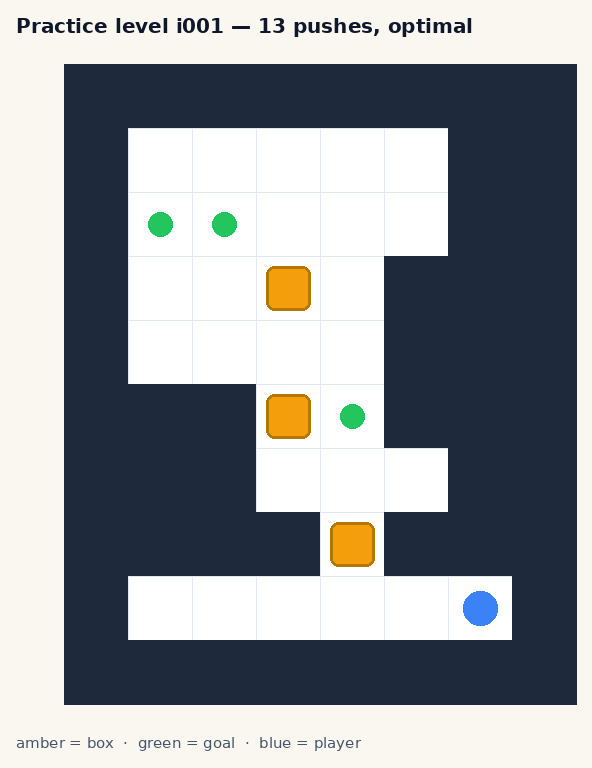

# Sokoban Solver — make.fun sokoban-solver-01-run-20261121

[](https://make.fun/bounty/sokoban-solver-01-run-20261121?utm_source=github&utm_medium=readme&utm_campaign=sokoban-solver-01-run-20261121)
[](https://make.fun/bounty/sokoban-solver-01-run-20261121/leaderboard?utm_source=github&utm_medium=readme&utm_campaign=sokoban-solver-01-run-20261121)
[](https://make.fun/bounty/sokoban-solver-01-run-20261121?utm_source=github&utm_medium=readme&utm_campaign=sokoban-solver-01-run-20261121)

Push-optimal Sokoban solver for the "Build the best Sokoban solver" bounty.
One program answers a set of 5 levels in one run: it reads
`/input/<id>/level.txt` (XSB) and writes `/output/<id>/solution.txt` (LURD moves).

## Run it

```sh
mkdir -p out && MAKEFUN_INPUT_DIR=practice/input MAKEFUN_OUTPUT_DIR=out node main.ts
```

Node 22, standard library only, no network, no wall clock. Deterministic: two
runs write the same bytes. A whole set solves in about a second, far inside the
60-second wall budget.

## The board



Practice level i001: three amber boxes, three green goals, one blue player.
The solver's room decomposition plus push-optimal A* clears every practice
level in exactly its optimal push count.

## Algorithm

The generated levels decompose: a hallway (the player's row) with 1–4 rooms off
it, each room holding 3–4 boxes and as many goals, and no box can ever cross a
door (a push through a door would need the player to stand in the wall row past
the one-wide hallway). So the level's push optimum is the sum of its rooms'
optima, and each room is solved on its own — the other rooms' boxes standing as
walls — the player walking on from room to room.

Each room is solved push-optimally with A* over pushes:

- A state is the boxes (sorted) plus the player's reachable region (named by its
  lowest square); between pushes the player walks freely, so only the region
  matters, not the exact square the player stands on.
- The heuristic is the cheapest assignment of boxes to goals (Hungarian, by
  brute-force permutations over at most 4 boxes) using shortest-path distances
  that ignore the other boxes: admissible and consistent, so the first solved
  state A* pops is push-optimal.
- Two deadlocks are pruned, neither of which can prune a solvable state: a box
  on a dead square (one from which no pull, ignoring the other boxes, ever
  reaches a goal) and a frozen 2×2 block of walls and boxes with a box off its
  goal.

If a room's A* exhausts its budget (400,000 expansions), a greedy best-first
search with the same pruning tries for any solution; if the level is no set of
rooms at all, the whole level is searched the same way. All budgets are counted
in work (state expansions), never in wall-clock time, and every tie is broken
by fixed order. One bad level never kills the set: any failure still writes a
valid (empty) answer for that level.

## Validation

Scored with the kit's sealed scorer (`program/scorer/score.ts`) against the
practice set and five freshly drawn sets (kit generator, different seeds):

| set | score | pushes (P*) |
| --- | --- | --- |
| practice | **1,000,000** | 13, 16, 29, 47, 60 |
| fresh #1 | **1,000,000** | 13, 14, 30, 47, 57 |
| fresh #2 | **1,000,000** | 12, 15, 32, 42, 65 |
| fresh #3 | **1,000,000** | 12, 14, 28, 51, 63 |
| fresh #4 | **1,000,000** | 12, 16, 29, 47, 59 |
| fresh #5 | **1,000,000** | 12, 14, 29, 48, 59 |

Every instance solved in exactly its push-optimal count P*. The house baseline
(plain-astar 1.0.0) scores 200,000 on the practice set — it solves only the
first level and gives up on the rest.

Edge cases verified by hand: a box already on its goal, an already-solved level
(empty solution), a box starting in the hallway (whole-level fallback), an
unsolvable level with a box in a corner (empty solution, no hang, no crash),
the player starting on a goal. Two runs on the practice set write byte-identical
outputs.

## Files

- `main.ts` — the solver (Node 22, standard library only)
- `README.md` — this file
- `LICENSE` — MIT
- `.makefun/owner.json` — the entry wallet
